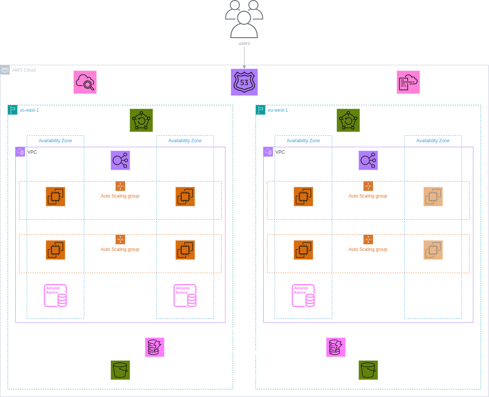
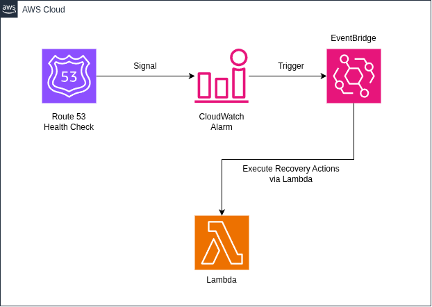

## Table of content
- [Solution Overview](#solution-overview)
- [Architecture Diagrams](#architecture-diagrams)
  - [Main Architecture](#main-architecture)
  - [Failover Automation Flow](#failover-automation-flow)
- [Architecture Componenets](#architecture-componenets)
- [Disaster Recovery Strategies](#disaster-recovery-strategies)
    - [RTO/RPO and Cost Comparison:](#rtorpo-and-cost-comparison)
    - [Why Warm Standby?](#why-warm-standby)
- [Failover and Recovery Workflow](#failover-and-recovery-workflow)
    - [1. Failure Detection](#1-failure-detection)
    - [2. DNS Failover](#2-dns-failover)
    - [3. Database Promotion](#3-database-promotion)
    - [4. Application Scaling](#4-application-scaling)
    - [5. Recovery Monitoring and Failback](#5-recovery-monitoring-and-failback)
- [Failover Considerations](#failover-considerations)
- [Data Protection and Backup Strategy](#data-protection-and-backup-strategy)
- [Infrastructure Deployment](#infrastructure-deployment)
- [Security Considerations](#security-considerations)
- [Cost Considerations](#cost-considerations)
- [Limitations](#limitations)

# Solution Overview
The solution demonstrates a multi-region disaster recovery strategy for a web application with Route 53 failover. A primary region (us-east-1) runs the primary stack. A secondary region (eu-west-1) maintains warm standby resources. Route 53 health checks detect primary region failure and automatically failover DNS. Failover actions automation is implemented by Lambda functions that are triggered by EventBridge on failover. Backups provide an additional layer of data protection against scenarios that replication cannot handle. Primary region's infrastructure will be restored and data will be synchronized to failback to the primary region.

The selected DR strategy for this solution is the **Warm Standby** strategy.

# Architecture Diagrams

The architecture is split into two diagrams:

## Main Architecture

*Primary region (us-east-1) containts the primary resources. Second region (eu-west-1) contains scaled-down enviornment*

## Failover Automation Flow

# Architecture Componenets
- **DNS & Routing:** Domains are managed by **Route 53** as the DNS and traffic manager using a failover active-passive routing policy.
- **Compute:** Provided using **EC2** instances for compute power, **Auto Scaling** for handling traffic changes and spikes, and **ALB** for HTTP/S path-based routing.
- **Database:** **Aurora Global Database** is configured to provide cross-region database replication. **DynamoDB Global Tables** provide active-active data replication for low-latency reads and writes across the two regions.
- **Storage:** **S3** stores application files, user-uploaded content, and static assets. **Cross-Region Replication** is configured to allow file accessibility when the primary region is unavailable.
- **Backup:** **AWS Backup** allows restoring data to an earlier recovery point and adding another recovery source with centralized backup plans for Aurora databases, EC2, and S3.
- **Security:** **IAM** is used to manage authentication and access to resources using permissions and different types of policies. Data is encrypted at rest with **KMS** using AWS-managed keys.
- **Monitoring:** Application metrics and alarms are managed through **CloudWatch** to monitor health of the resources and make sure the application is running smoothly.
- **Automation:** **EventBridge** and **Lambda** are used to handle the recovery actions that should be taken during a failover.
- **Infrastructure:** **CloudFormation StackSets** are used to handle the creation and deployment of the application infrastructure across the two regions.

# Disaster Recovery Strategies
Having a look at the four main disaster recovery strategies:  
1. **Backup & Restore** 
   - Consists of taking regular backups stored in a cost-optimized storage. When a disaster or a failure occurs, data is pulled back from S3 in a DR region. If on-premises, data can be downloaded from S3 to on-premises servers.
   - AWS Backup is typically used to automate backups across services form a central place.
   - Offers the most cost-effective DR solution, but the highest RTO/RPO.
2. **Pilot Light**
   - This strategy keeps a minimal, always-on version of your environment in a secondary region.
   - Typically, the database is actively running and replicating data while other infrastructure and pre-configured but not running.
   - When a disaster occurs, compute is scaled up and traffic is redirected to the DR region.
   - Recovery is not instant, but offers a lower RTO/RPO compated to the Backup & Restore strategy.
3. **Warm Standby**
   - This strategy runs a scaled-down clone of your production environment in the DR region at all times.
   - All the infrastructure is running, unlike Pilot Light, but is scaled down.
   - On failover, you scale out the standby environment to full production size and shift traffic.
   - This strategy offers a lower RTO/RPO than Pilot Light.
4. **Multi-Site Active-Active**
   - This strategy runs two identical, production-scale environments simultaneously in different regions, both actively serving traffic.
   - If one Region fails, the other absorbs 100% of traffic with no downtime.
   - Offers the lowest RTO/RPO of near zero, but incurs the highest costs  
  
### RTO/RPO and Cost Comparison:
| Strategy | Backup & Restore | Pilot Light | Warm Standby | Multi-Site |
|:-------------|:--------------:|:--------------:|:--------------:|:--------------:|
| **RTO/RPO**         |    Hours      |         Tens of minutes |    Minutes      |         Near-zero |
| **Cost**         |     Lowest       |          Low |    Medium      |         Highest |

### Why Warm Standby?
This application is running production workloads that contains critical user data that needs to be kept safe and available at any time. Keeping that in consideration and for optimizing costs, the optimal solution for this case was pointing towards the Warm Standby DR patten.

# Failover and Recovery Workflow
Failover and recovery workflow involves multiple steps:  

### 1. Failure Detection
- Route 53 continues to route traffic to the primary region's ALB, but the requests fails to reach the endpoint.
- After failing a treshold of checks, Route 53 marks it unhealthy and stops routing traffic to it.
- CloudWatch receives the health check metrics and triggers an alarm.
- When the alarm enters the `ALARM` state, an EventBridge rule detects the state change and triggers the recovery Lambda function.

### 2. DNS Failover
- Route 53 uses a Failover routing policy with two records:
  1. Primary record pointing to the Application Load Balancer in `us-east-1`.
  2. Secondary record pointing to the Application Load Balancer in `eu-west-1`.
- After the first record changes changes state to unhealthy, Route 53 stops routing traffic to the primary record and starts routing to the secondary record.
- A DNS TTL configured at **60 seconds** will then cache the new route, so for existing caches, traffic may not switch immediately.

### 3. Database Promotion
- The recovery Lambda function starts the database recovery process.  
  
- For Aurora Global Database:
  - The secondary aurora cluster is read-only by default.
  - During a regional failure, the second cluster is promoted to become the primary cluster allowing write operations.
  - Applications in the secondary region can then perform operations on the newly promoted cluster.

- For DynamoDB Global Tables:
  - Data was already actively replicated to the secondary region.
  - The secondary region can continue to accept reads and writes to its replica.

### 4. Application Scaling
- Since we are using the Warm Standby DR strategy, the secondary region already has minimal running instances.
- The recovery Lambda function performs the following scaling actions for the Auto Scaling Group in `eu-west-1`:
    - Increases the desired instance capacity.
    - Launches more EC2 instances.
- The Application Load Balancer performs health checks on the new instances.
- If healthy, the instances become available to receive traffic.
  
### 5. Recovery Monitoring and Failback
- After failover, `eu-west-1` becomes the active region, while `us-east-1` remains unavailable until restored.
- CloudWatch continues to monitor the secondary region, and AWS Backup provides additional recovery options if data restoration becomes necessary.
- Once the primary region `us-east-1` is recovered, a failback process can begin following these steps:
    1. Restore and verify the infrastructure in `us-east-1`.
    2. Synchronize data from the active secondary region.
    3. Switch Aurora Global Database primary cluster to make `us-east-1` the writer cluster again.
    4. Verify that the application is operating properly in the primary region.
    5. Modify Route 53 to route to the primary region
    6. Scale down the secondary region to the Warm Standby capacity.

# Failover Considerations
Something to consider about this failover strategy is that Route 53 DNS failover happens independently of Lambda's recovery actions. This adds a possibility that the users might reach the secondary region before:
- Aurora has been promoted.
- EC2 capacity has been increased.
- The application is ready to accept requests.

At the moment, this is handled by the application through retries until Auroa promotion and scaling is completed.

# Data Protection and Backup Strategy
The strategy consists of combining multiple services and layers of data protection as follows:

**1. Aurora Global Database replication**
- Aurora Global Databases allows spanning multiple regions providing asynchronous data replication.
- The primary cluster in `us-east-1` handles both reads and writes, while the secondary region can serve low-latency reads for global users.
- In a disaster, the secondary region can be promoted to primary in **under 1 minute** for RTO < 1 minute and RPO < 1 second.

**2. S3 Cross-Region Replication**
- Cross-Region Replication allows S3 to replicate objects from the source S3 bucket in `us-east-1` to the bucket in `eu-west-1` for usage if the primary region becomes unavailable.

**3. DynamoDB Global Tables**
- Global Tables allows multi-region, active-active replication for DynamoDB tables.
- This makes any updates made in one region be replicated to the other one automatically, providing high availability.

**4. AWS Backup plans and cross-region backup copies**
- As another layer of data protection, AWS Backup creates scheduled backups of Aurora databases, EC2, and S3.
- Backup plans define backup schedules, retention period, and cross-region copy rules.
- Recovery points are stored in a primary backup vault in `us-east-1`, with copies made in a secondary backup vault in `eu-west-1`.
- This allows the resouces to be restored in a specific point in time in case of a disaster or if data is accidentally deleted.

# Infrastructure Deployment
For consistency, deployment of the infrastructure is done using **CloudFormation** for IaC which will enable:
- Repeatable deployments
- Version control for infrastructure changes
- Automated cleanup

By leveraging the CloudFormation StackSets feature, deployments across multiple accounts and regions will be enabled. This will extend the stacks to deploy byond just the primary region from a single operation. For implemeting region-specifc configurations, mappings and pseudo parameters are used.

# Security Considerations
For security assurance, multiple considerations are taken:

- **IAM roles and least privilege:** User permissions are managed through IAM roles for granting temporary permissions depending on the use case. The principle of Least Privilege is put into consideration for granting only the necessary permission for the user to perform his specific tasks and nothing more.  

- **Security Groups:** Access to instances is limited by leveraging security groups at the instance level. This adds traffic filtering and blocks unwanted and suspicous traffic from accessing the instances.

- **KMS encryption:** Data at AWS resources is encrypted using Managed KMS Keys. Keys are automatically rotated every year to make sure that a single key is used only for a specific period of time, reducing the amount of data exposed if a key is stolen.

- **Backup vault protection:** The backup vault protection enforces Write-Only-Read-Many model to prevent users, including the root account, from deleting or modifying recovery points before their retention period ends.

# Cost Considerations
Multiple factors of cost should also be considered when implementing this solution:
- **EC2 standby costs:** The secondary region runs scaled-down but functioncal EC2 instances. These instances incur compute costs. Costs can be reduced by using smaller instance types, Savings Plans, or Reserved Instances for baseline capacity.
- **Aurora Global Database costs:** The secondary region's cluster charges for instances, storage, and inter-region data transfers per GB.
- **S3 replication and storage costs:** Cross-Region Replication incurs storage costs in the secondary region, in addition to the requests to replicate objects in the bucket. Transfer costs are charged for inter-region transfers.
- **Backup storage costs:** Backup snapshots and cross-region copies incur costs per GB/month.
- **Monitoring and automation costs:** You are charged for CloudWatch metrics, alarms, Route 53 health checks, EventBridge, and Lambda for failover automation.

# Limitations
- **DNS propagation and caching:** Even with 60 seconds TTL, some clients cache records longer, so not all users will switch over immediately.
- **Asynchronous replication:** Aurora Global Database and S3 CRR replicate asynchronously, so the standby may lag behind the primary.
- **Potential data loss:** Because of the lag, there is a possibility of losing some data if the primary fails before the replication completes.
- **Recovery automation limitations:** Automation scripts run by Lambda depend on APIs and credentials that must be available during the failover. Scaling up takes time for instances to launch, warm up, health checks, etc., so RTO is in minutes not zero.